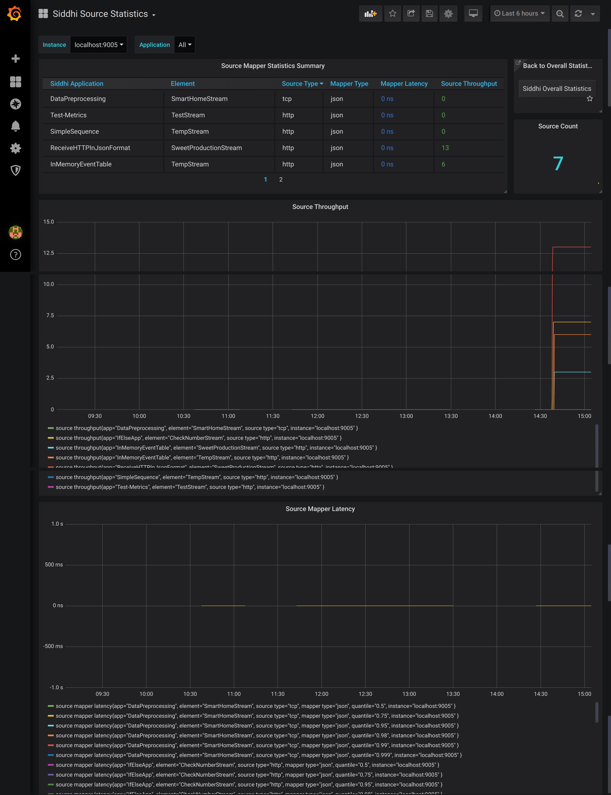

# Viewing Source Statistics

:::info[Documentation in progress]

For a summary of the metrics shown in this dashboard, see [Source and Source Mapper Statistics in the Overall Statistics dashboard](viewing-overall-statistics.mdx#source-and-source-mapper-statistics).

:::

This dashboard displays the following information for your current WSO2 Integrator: SI deployment:
