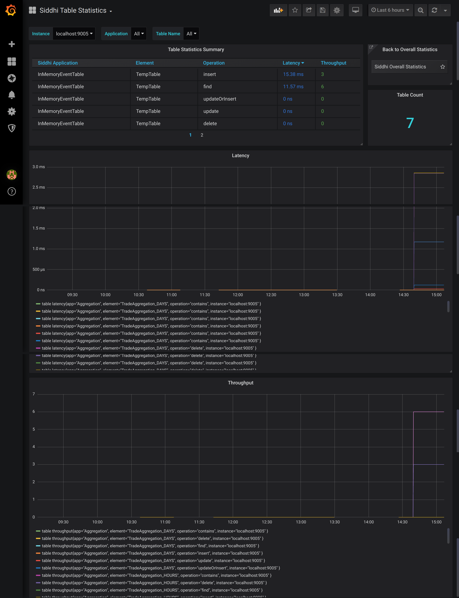

# Viewing Table Statistics

:::info[Documentation in progress]

For a summary of the metrics shown in this dashboard, see [Table Statistics in the Overall Statistics dashboard](viewing-overall-statistics.mdx#table-statistics).

:::

This dashboard displays the following information for your current WSO2 Integrator: SI deployment:
