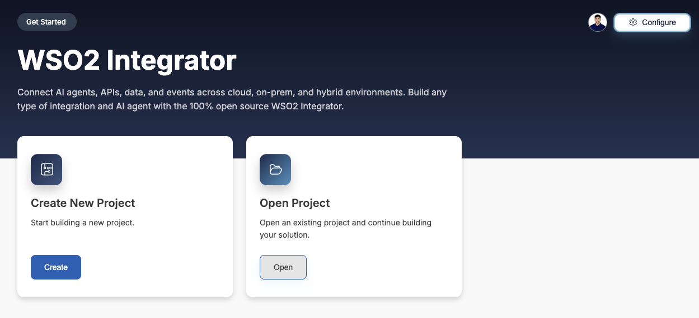
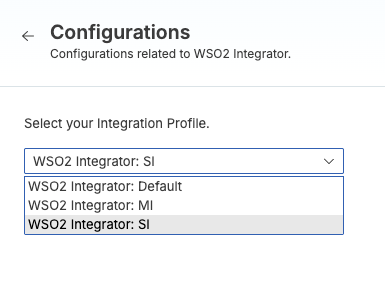
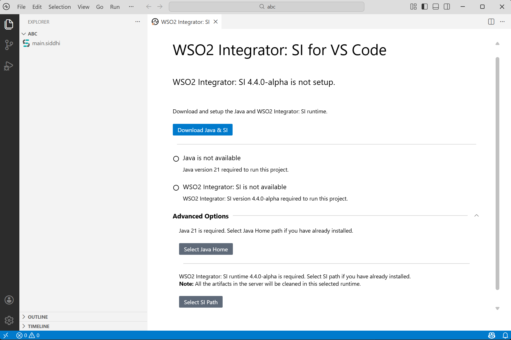
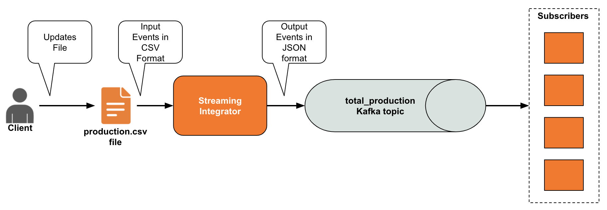
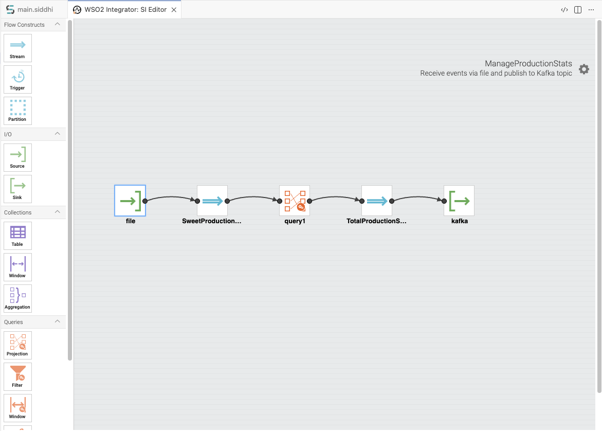
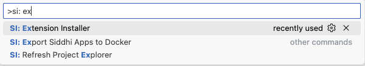
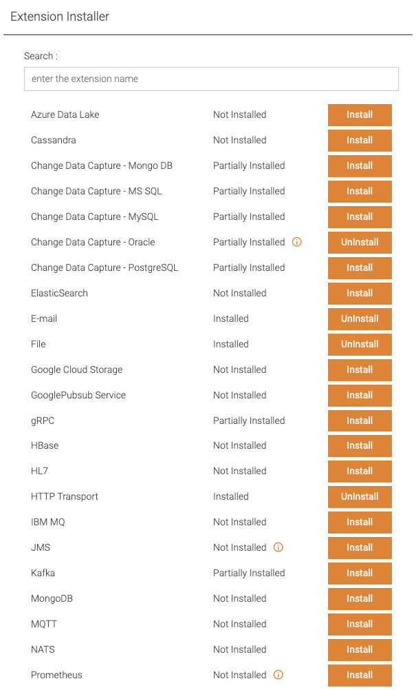

# WSO2 Integrator: SI Quick Start Guide

## Introduction

This quick start guide gets you started with the WSO2 Integrator: SI (SI), in just 5 minutes.

In this guide, you will set up WSO2 Integrator: SI, download Kafka, and try out a simple Siddhi application. The Siddhi application consumes messages from a file, processes the data, generates an output, and publishes that output to a Kafka topic.

<Steps>

## Download and start WSO2 Integrator: SI {/* #step-1-download-and-start-wso2-integrator-si */}

1. Download WSO2 Integrator from the [WSO2 Integrator downloads page](https://wso2.com/products/downloads/?product=wso2integrator) and install it.

2. Open WSO2 Integrator. The home page opens with a **Configure** button in the top right corner.

    

3. Click **Configure**. The **Configurations** panel opens.

4. Under **Select your Integration Profile**, choose **WSO2 Integrator: SI**.

    

5. WSO2 Integrator opens the SI setup page. If Java 21 or the SI runtime is not detected, you are prompted to install them. Click **Download Java & SI** to install both automatically.

    

    :::tip

    If you already have Java 21 or the SI runtime installed, expand **Advanced Options** to point WSO2 Integrator at your existing `JAVA_HOME` and SI installation directory. The SI installation directory is referred to as `<SI_HOME>` from here on.

    :::

## Download Kafka {/* #step-2-download-kafka */}

Download the Kafka broker from [the Apache site](https://archive.apache.org/dist/kafka/2.5.0/kafka_2.12-2.5.0.tgz) and extract it. This directory is referred to as `<KAFKA_HOME>` from here on.

## Create a simple Siddhi application {/* #step-3-create-a-simple-siddhi-application */}

Let's create a simple Siddhi application that reads data from a CSV file, performs a simple transformation on the data, and then publishes the results to a Kafka topic so that multiple subscriber applications can have access to that data.



1. Download the `productions.csv` file from [here](../../assets/tutorials/resources/productions.csv) and save it in a location of your choice.

    :::info

    In this example, the file is located in the `<YOUR_HOME>` directory.

    :::

2. In WSO2 Integrator: SI, open a new file, paste the following Siddhi application into it, and save it as `ManageProductionStats.siddhi`.

    ```sql
    @App:name('ManageProductionStats')
    @App:description('Receive events via file and publish to Kafka topic')

    @source(type = 'file', mode = "LINE", file.uri = "file:<YOUR_HOME>/productions.csv", tailing = "true",
        @map(type = 'csv'))
    define stream SweetProductionStream (name string, amount double);

    @sink(type = 'kafka', bootstrap.servers = "localhost:9092", topic = "total_production", is.binary.message = "false", partition.no = "0",
        @map(type = 'json'))
    define stream TotalProductionStream (name string, amount double);

    -- Simple Siddhi query to calculate production totals.
    @info(name = 'query1')
    from SweetProductionStream
    select name, sum(amount) as amount
    group by name
    insert into TotalProductionStream;
    ```

    :::note

    Replace `<YOUR_HOME>` in the `file.uri` attribute with the actual directory where you saved `productions.csv` in the previous sub-step.

    :::

    The above Siddhi application reads input data from `productions.csv` in CSV format, processes it, and publishes the resulting output to a Kafka topic named `total_production`. Each input event reports the amount of a specific sweet produced in a production run, and the application calculates the running total amount produced for each sweet.

    :::tip

    You can also build this application visually in the **Graphical Design View** of WSO2 Integrator: SI by dragging and dropping flow constructs.

    

    :::

## Install the required Kafka extension {/* #step-4-install-the-required-kafka-extension */}

The `ManageProductionStats` Siddhi application uses a Kafka sink, but the Kafka Siddhi extension is not installed by default. To install it:

1. In WSO2 Integrator, open the command palette by pressing `Ctrl + Shift + P` (or `Cmd + Shift + P` on macOS), type `SI: Extension Installer`, and select the **SI: Extension Installer** option.

    

2. The **Extension Installer** panel opens. Scroll to **Kafka** and click **Install**.

    

3. Reload WSO2 Integrator after the installation completes so that the new extension is picked up.

## Start Kafka and create a topic {/* #step-5-start-kafka-and-create-a-topic */}

Let's start the Kafka server and create a Kafka topic so that the `ManageProductionStats` application you created can publish its output to it.

To start Kafka:

1. Navigate to the `<KAFKA_HOME>` directory and start a zookeeper node by issuing the following command.

    `sh bin/zookeeper-server-start.sh config/zookeeper.properties`

2. Navigate to the `<KAFKA_HOME>` directory and start a Kafka server node by issuing the following command.

    `sh bin/kafka-server-start.sh config/server.properties`

To create a Kafka topic named `total_production`:

1. Navigate to the `<KAFKA_HOME>` directory and issue the following command:

    `bin/kafka-topics.sh --create --bootstrap-server localhost:9092 --replication-factor 1 --partitions 1 --topic total_production`


## Test your Siddhi application {/* #step-6-test-your-siddhi-application */}

To test the `ManageProductionStats` Siddhi application you created, follow the steps below.

1. In WSO2 Integrator: SI, open the `ManageProductionStats.siddhi` file and click the **Run** button (▶) in the toolbar. WSO2 Integrator starts the SI runtime and deploys the Siddhi application.

2. Open the `<YOUR_HOME>/productions.csv` file and append the following five rows, making sure to press Enter after the last row so the file ends with a newline, then save your changes.

    ```csv
    Toffee,40.0
    Almond cookie,70.0
    Baked alaska,30.0
    Toffee,60.0
    Baked alaska,20.0
    ```

3. To observe the messages in the `total_production` topic, navigate to the `<KAFKA_HOME>` directory and issue the following command:

    `bin/kafka-console-consumer.sh --bootstrap-server localhost:9092 --topic total_production --from-beginning`


You can see the following message in the Kafka Consumer log.

```text
{"event":{"name":"Almond cookie","amount":100.0}}
{"event":{"name":"Baked alaska","amount":20.0}}
{"event":{"name":"Toffee","amount":40.0}}
{"event":{"name":"Almond cookie","amount":170.0}}
{"event":{"name":"Baked alaska","amount":50.0}}
{"event":{"name":"Toffee","amount":100.0}}
{"event":{"name":"Baked alaska","amount":70.0}}
```

</Steps>


## What's next?

Once you try out this quick start guide, you can proceed to one of the following sections.

- Learn the basic functionality of the WSO2 Integrator: SI in less than 30 minutes by [Creating Your First Siddhi Application](first-siddhi-app/overview.mdx).

- Try out [WSO2 Integrator: SI tutorials](../tutorials/tutorials-overview.mdx).

- Learn how to run WSO2 Integrator: SI in containerized environments by trying [Running SI with Docker and Kubernetes](../tutorials/running-si-with-docker-and-kubernetes.mdx).
