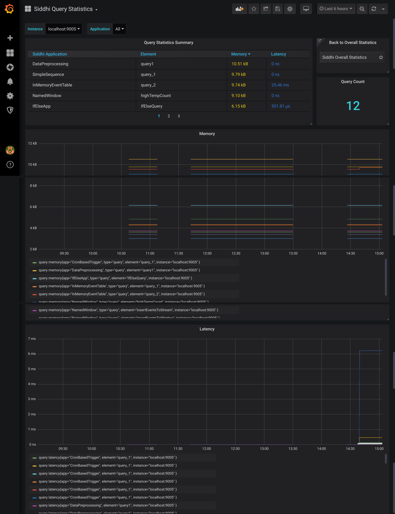

:::note

**This page is still a work in progress!**

:::
    
# Viewing Sink Statistics

This dashboard displays the following information for your current WSO2 Streaming Integrator deployment:

- The throughput of each query
- The total query count
- The memory consumed by the queries over time.
- The latency of the queries over time
