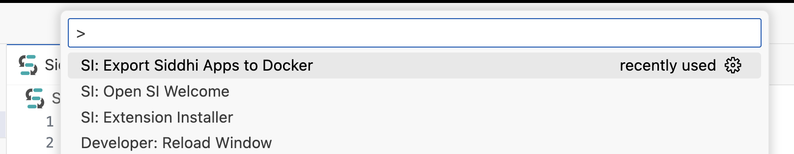
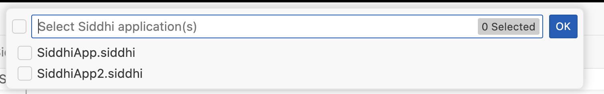
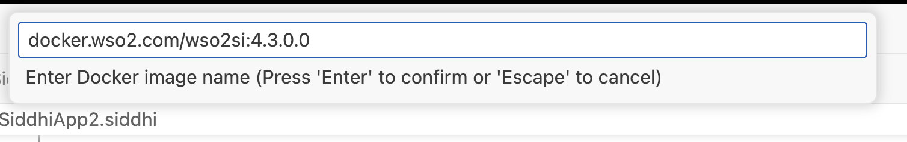
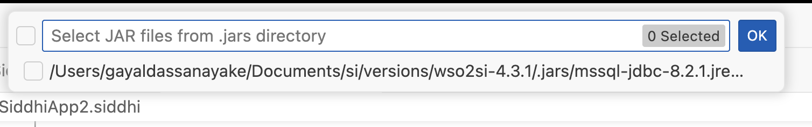
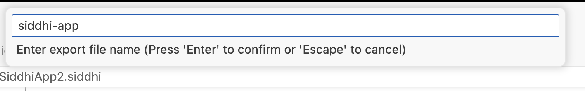

# Deploying Siddhi Applications

After creating and testing a Siddhi application, you can to deploy it in Docker and Kubernetes.

To deploy your Siddhi application in docker, follow the procedure below:

1. Open VSCode in the directory where your Siddhi application is located.
2. Open the command palette by pressing `Ctrl + Shift + P` (or `Cmd + Shift + P` on macOS), and type **SI: Deploy Siddhi Apps to Docker**. Select this command.

    

    The Siddhi App selection dialog box opens as follows.

    

3. Enter the Docker image name.

    

4. Select the JAR files of Siddhi extensions that you want to include in the Docker image. If you do not select any JAR files, the default Siddhi extensions are included.

    

5. Provide the export file name.

    

6. Once completed, a zip will be created in the workspace directory with the following structure:

    ```
    .
    ├── Dockerfile
    ├── README.md
    └── siddhi-files
        ├── <SIDDHI_FILE>.siddhi
        ├── ...
        └── <SIDDHI_FILE>.siddhi
    ```
