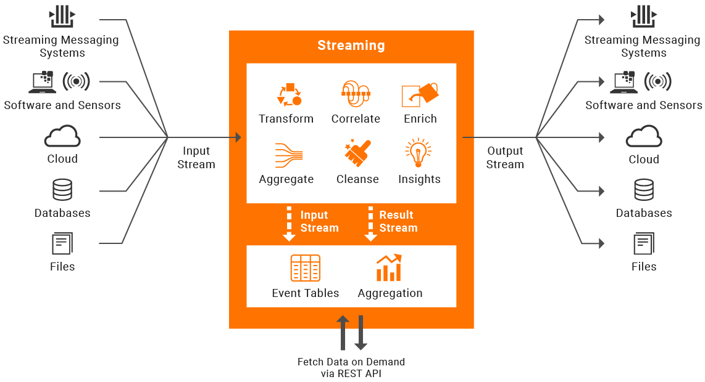

# Introduction

WSO2 Integrator: SI is a streaming data processing server that integrates streaming data and takes action based on streaming data.

SI can be effectively used for:

- **Realtime ETL**: CDC for DBs, tailing files, scraping HTTP Endpoints, etc.
- **Work with streaming messaging systems**: It is fully compatible with Kafka and NATS, and provides advanced stream processing capabilities required to utilize the full potential of streaming data.
- **Streaming data Integration**: Allows you to treat all data sources as streams and connect them with any destination.
- **Execute complex integrations based on streaming data**: SI has native support to work hand-in-hand with WSO2 Integrator: MI to trigger complex integration flows based on decisions derived via stateful stream processing logic.

:::info[Try it out!]

To try out each of the above use cases with SI, see [Tutorials](../examples/tutorials-overview.mdx)

:::

## Key Features

WSO2 Integrator: SI is powered by [Siddhi.io](https://siddhi.io/), a well-known cloud native open source stream processing engine. Siddhi allows you to write complex stream processing logic using an intuitive SQL-like language known as [SiddhiQL](https://siddhi.io/en/v5.1/docs/). You can perform the following actions on the fly using Siddhi queries and constructs.

- [**Extracting data from static sources in real time**](../guides/extracting-data-from-static-sources-in-real-time.mdx).
- [**Loading and writing data**](../guides/loading-and-writing-date.mdx) to databases, files and cloud based storages.
- [**Receiving data in transit**](../guides/receiving-data-in-transit.mdx) from message brokers and data publishers.
- [**Publishing data**](../guides/publishing-data-to-event-stream-consumers.mdx) to destinations.
- [**Stream processing**](../guides/processing-data.mdx) activities including cleansing, transforming, enriching correlating, and summarizing data.
- [**Performing real time ETL**](../guides/performing-etl-tasks.mdx).
 
 

With 60+ prebuilt and well-tested collection of connectors, SI allows you to connect any data source with any destination regardless of the different protocols and data formats used by the different endpoints.

The SI Store API exposes aggregated and collected data streams to in-memory and persistence storages via a REST API, allowing you to execute queries and generate summarized information on demand.

Synapse integration flows deployed in [WSO2 Integrator: MI](https://github.com/wso2/micro-integrator) can be executed directly by SI. This allows you to build robust data processing and integration pipelines by combining powerful stream processing and integration capabilities.

## Tooling

SI is coupled with the [WSO2 Integrator: SI VSCode extension](../develop/si-for-vscode-overview.mdx); a comprehensive streaming integration flow designer for [**developing**](../develop/creating-a-Siddhi-Application.mdx)) Siddhi applications
 by writing queries or via the drag-and-drop functionality, [**testing**](../develop/testing-a-Siddhi-Application.mdx) them thoroughly before using them in production, and then **deploying** them in the SI server or [exporting them to be deployed as a K8 or a Docker image](../develop/exporting-Siddhi-Applications.mdx).

## Centralized and Decentralized Deployment

Being container-friendly by design with a small image size, low resource footprint, a startup time less than two seconds, etc., SI can be easily deployed in VMs, Docker or K8s.

Its native support for Kubernetes with a [K8s Operator](https://siddhi.io/en/v5.1/docs/siddhi-as-a-kubernetes-microservice/) provides a convenient way to deploy SI on a K8s cluster with a single command, thereby eliminating the need for manual configurations.

Deploying SI as a highly available [minimum HA cluster](../setup/deploying-si-as-minimum-ha-cluster.mdx) allows you to achieve zero data loss with just two SI nodes.

:::tip[What's Next]

- [Quick Start Guide](../quick-start-guide/quick-start-guide.mdx) 
- [Create Your First Siddhi Application](../quick-start-guide/getting-started/getting-started-guide-overview.mdx)

:::
